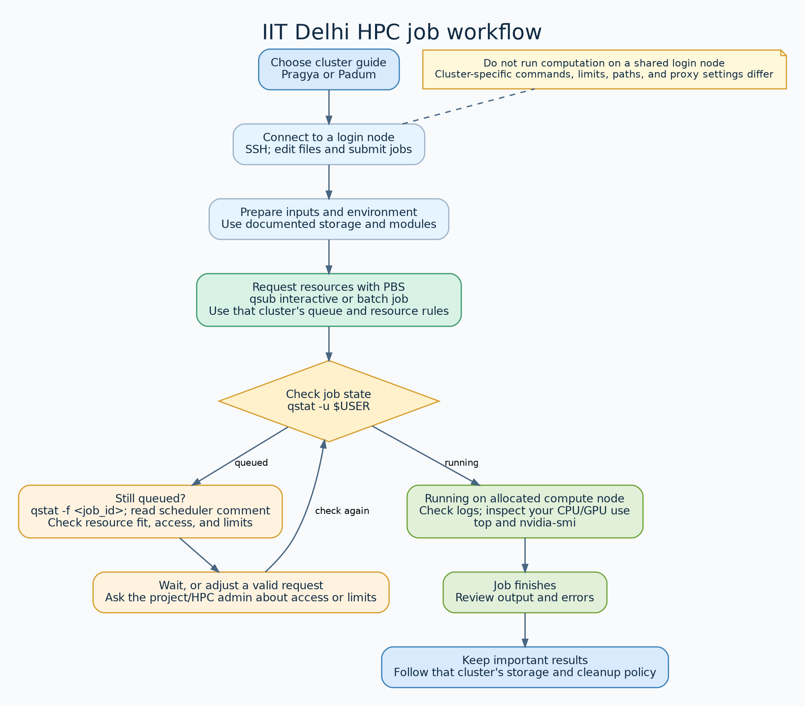

# IIT Delhi HPC Guide

A practical, evolving reference to IIT Delhi's Pragya and Padum HPC systems. ✅ marks direct testing; ⚠️ marks a claim drawn from documentation, community repositories, or inference. Padum availability reporting has been tested directly; other Padum operational guidance remains research-based unless marked ✅.

## Choose a cluster

- **[Pragya](docs/pragya/README.md):** directly tested, with PBS guidance and a live resource availability tool.
- **[Padum](docs/padum/README.md):** community-sourced guidance for the older `hpc.iitd.ac.in` system, with a tested PBS availability report; other operational details remain unverified.

## Shared topics

[FAQ and cross-cluster notes](docs/faq.md) collects general questions and clearly separates any cluster-specific answers. [Field notes, November 2026](docs/field-notes-2026-11.md) records observations from running CPU-only batches on both clusters. Raw, cited source material is in [docs/sources](docs/sources/).



Editable diagram source: [`docs/hpc-job-workflow.dot`](docs/hpc-job-workflow.dot).

## Repository layout

```text
docs/pragya/       Verified Pragya guide (plus its open questions)
docs/padum/        Padum guide with per-claim verification and open questions
docs/sources/      Raw external research notes
examples/pragya/   Pragya PBS example
examples/padum/    Padum PBS template (unverified)
util_pbs.py        Shared PBS availability reporting
check_free_nodes.sh  Shared availability wrapper
```

## Availability tools

On either cluster’s login node, with Python 3, pandas, `pbsnodes`, and `qstat` available:

```bash
bash check_free_nodes.sh
```

Cluster labels are automatically detected from PBS node names. Override with an environment variable or command option (the option takes precedence):

```bash
HPC_CLUSTER=padum bash check_free_nodes.sh
bash check_free_nodes.sh --cluster pragya
```

Use `export HPC_CLUSTER=padum` in your Padum shell setup if you prefer a fixed selection; use `pragya` on Pragya. `--cluster auto` explicitly requests detection, overriding the environment. Selection changes labels and queries the local PBS server.

For offline input, pass both captures; detection uses the captured node names:

```bash
python3 util_pbs.py --nodes-json <pbsnodes.json> --jobs-json <qstat.json>
```

Unknown clusters use generic node prefixes; mixed known cluster names require an explicit selection. See [Padum availability](docs/padum/06-checking-availability.md) for verification and migration details.

## Fetch both clusters from your own machine

Run the standard-library Python client locally; it fetches the existing remote reports concurrently without copying scripts or submitting jobs:

```bash
python3 fetch_free_nodes.py --user <kerberos_id>
# Optional explicit SSH key:
python3 fetch_free_nodes.py --user <kerberos_id> --identity ~/.ssh/id_ed25519
```

To avoid repeating your account, set `HPC_SSH_USER` in your local shell (do not commit its personal value):

```bash
export HPC_SSH_USER=<kerberos_id>
python3 fetch_free_nodes.py
```

The client loads remote `~/.bashrc` using `bash -ic`, activates `pragya` on `pragya.iitd.ac.in` and `hpc` on `login5.hpc.iitd.ac.in`, then runs `bash check_free_nodes.sh` from `~/HPC-IITD-Guide`. Prerequisites: Python 3 and OpenSSH locally; registered SSH keys, trusted host keys already in `known_hosts`, and the existing repo/environment on both servers. It never prompts for passwords or accepts unknown host keys automatically.

Options: `--cluster pragya` or `--cluster padum`, `--repo <remote-path>`, `--timeout 180` (default 120 seconds per server), and `--json`. JSON retains each cluster's raw stdout, stderr, UTC request-start timestamp (`fetched_at`), and exit code. Reports remain separate because remote checkout versions can differ. Exit status is 1 if either cluster fails; the successful report is still returned. Shell job-control warnings are retained as diagnostics, not treated as failures when execution succeeds.

✅ On 2026-10-11, the local client fetched both live reports successfully with the respective environments confirmed and both remote exit codes 0. It preserves the remote report text, which may include other users' job identifiers; do not commit saved output. Free resources do not imply queue eligibility, suitable GPU hardware, or immediate job starts.

Local regression checks (no HPC access required):

```bash
python3 -m unittest discover -s tests -v
```

## Contributing

Add findings to the relevant cluster page in the same session. Cite sources for untested details and retain ⚠️ until direct verification; date values that can change. Keep one canonical home per fact, update links and indexes when moving pages, and never commit passwords, tokens, personal identifiers, or project codes.
